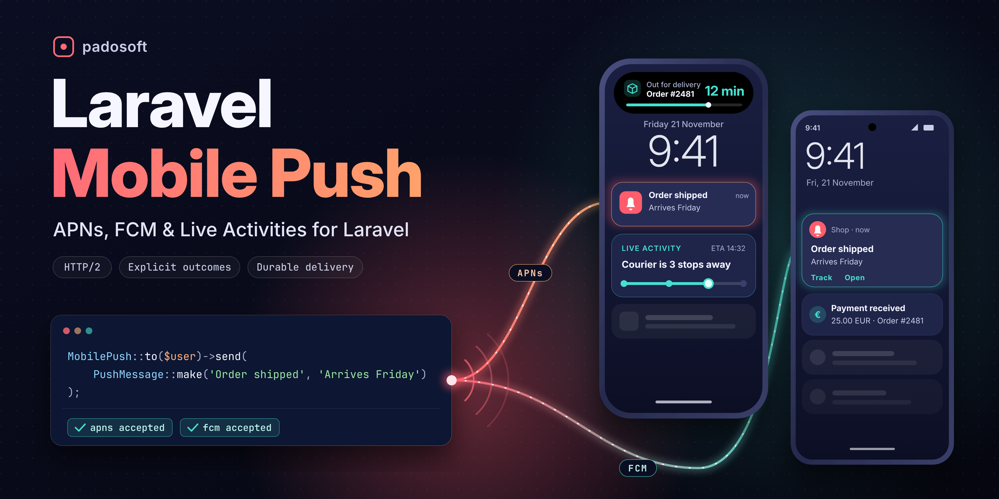

# Laravel Mobile Push

[](https://github.com/padosoft/laravel-mobile-push/actions/workflows/tests.yml)
[](LICENSE)



> **APNs, FCM and Live Activities for Laravel: send push notifications directly to Apple and Google over HTTP/2, and always know what happened to each one.** One call reaches a user's iPhone through APNs and their Android phone through FCM HTTP v1, with no intermediate service, and returns one explicit result per device: accepted, rejected, deferred, or honestly unknown.

```php
MobilePush::to($user)->send(PushMessage::make('Order shipped', 'Arrives Friday'));
```

## Project status

**Pre-release.** The package is complete enough to try, but read this before you rely on it:

- It is verified against a **protocol-level HTTP/2 mock server** (a Node `http2` server that counts what it receives, drops connections, resets streams and sends `GOAWAY`) and against the providers' **published schemas** (Apple's documentation, the FCM Discovery document revision 20261112). The suite has more than two thousand tests.
- It has **never been run against the real APNs or FCM servers, nor on a real device**, in this project. Real-provider verification is the next step before 1.0.

Specific points not yet verified against the real services or infrastructure:

- which of Apple's two documented hosts for publishing Live Activity **broadcasts** is operational (`broadcast_host`: `standard` or `api-broadcast`), and whether the broadcast host expects `apns-request-id` (what the package sends) or `apns-id`;
- the exact **FCM payload-size counting rule**: Google publishes the 4096 / 2048-byte limits but not how they are measured; the package applies a conservative rule of its own ([messages.md](docs/messages.md#size-limits-and-truncation));
- FCM error codes and minimum delays come from the official Firebase Admin SDK sources, not from Google's web pages; the error strings of APNs broadcast **channel management** come from Apple's documentation by name;
- the decoding of the topic and environment extensions of **Apple push certificates** (never tried on a real certificate);
- **concurrency of the durable ledger on MySQL and PostgreSQL** (`SKIP LOCKED` claims are exercised on SQLite only, where the lock clause is ignored) and of **cache locks on Redis**; queues were tested with Laravel's local test drivers, not with Redis, SQS or Horizon;
- long-lived runtimes beyond queue workers: **Octane / Swoole / RoadRunner** have not been tested;
- **Application Default Credentials** on Google Cloud, the iOS Simulator command (`xcrun`) on a real Mac, the Pulse card and Telescope entries in a browser, and five cells of the [capability matrix](docs/messages.md#the-capability-matrix) marked "unverified".

If you try it against the real services, an issue with what you saw (even "it worked") is the most useful contribution right now.

## Why this package

- **Explicit outcomes, including "unknown".** Every device ends with one status: `Accepted`, `Rejected`, `Failed`, `Deferred`, `Expired`, `Skipped`, `Simulated`, `Validated`, or `OutcomeUnknown` when the request left but the answer was lost. An unknown outcome is never reported as a failure, never triggers a fallback channel or a token invalidation, and an alert is not resent blindly.
- **No silent duplicates from libcurl.** libcurl re-sends by itself a request whose connection died, even one the server had already processed; the package streams request bodies so such a re-send fails instead of pushing twice. The investigation and the measurements are in [docs/transport.md](docs/transport.md).
- **One HTTP/2 connection reused per credential.** In a queue worker, requests are multiplexed over a persistent connection per credential identity (bounded, closed when idle, safe across `fork()`), instead of a new TLS handshake per batch.
- **Provider tokens handled for you.** The APNs JWT is renewed within Apple's 20–60 minute rules by one process at a time and shared through your cache; the Google OAuth token likewise. A secondary credential takes over when the primary keeps failing.
- **Typed destinations, nothing guessed.** A token is an `ApnsDeviceToken`, an `FcmToken`, an `FcmFid`, a topic...; the platform, the APNs environment and the app are always declared, never inferred from the shape of a string.
- **Safe by default outside production.** With the default `auto` mode, only `APP_ENV=production` sends for real; elsewhere every send is simulated, and going live requires an explicit allowlist of test devices.
- **Durable when you need it.** The optional durable profile records every delivery in a ledger with an outbox before sending (inside your database transaction), records each outcome before acknowledging the job, and deduplicates by effect key.
- **Live Activities, broadcast channels included.** Start (push-to-start), update and end activities, and create and publish to iOS 18 broadcast channels: one publication for every subscriber.
- **First-class testing fakes.** `MobilePush::fake()` checks what your code asked to send; `MobilePush::fakeTransport()` runs the real pipeline and checks the exact bytes. Neither needs credentials.
- **Redaction everywhere.** Device tokens, bearer tokens and receipt markers never reach logs, events, Telescope, Pulse or OpenTelemetry; tokens are encrypted at rest and looked up through a keyed HMAC index.

## Requirements

- PHP 8.3 or newer with `ext-curl`, `ext-openssl`, `ext-json`, and a libcurl built with HTTP/2 (7.68 or newer; `php artisan mobile-push:doctor` checks it).
- Laravel 12 or 13.
- Optional: `ext-intl` (exact grapheme truncation), `google/auth` (Application Default Credentials for FCM), `open-telemetry/api`, `laravel/pulse`, `laravel/telescope`, `spatie/laravel-health`.
- A cache store shared by your workers and able to take locks (Redis, Memcached, database, DynamoDB) in production.

## Quick start

A complete, slower walkthrough with the real output of every command is in [docs/getting-started.md](docs/getting-started.md).

**1. Install.**

```bash
composer require padosoft/laravel-mobile-push
```

**2. Run the installer.** Answer "no" to the optional modules and choose the `light` profile for a first try.

```bash
php artisan mobile-push:install
```

It publishes `config/mobile-push.php` and prints the variables and workers you need.

**3. Create the APNs key (iOS).** In your Apple developer account, create a key with the *Apple Push Notifications service* capability and download the `.p8` file (Apple lets you download it only once). Note the **Key ID** and your **Team ID**. Details, key scopes and certificates: [docs/credentials-apns.md](docs/credentials-apns.md).

**4. Create the Firebase service account (Android).** In the Firebase console, *Project settings → Service accounts*, generate a private key and download the JSON file. Details and least privilege: [docs/credentials-fcm.md](docs/credentials-fcm.md).

**5. Fill in `.env`.**

```dotenv
MOBILE_PUSH_APNS_TEAM_ID=ABCDE12345
MOBILE_PUSH_APNS_KEY_ID=ABC123DEFG
MOBILE_PUSH_APNS_KEY_PATH=/var/www/app/storage/push/AuthKey_ABC123DEFG.p8
MOBILE_PUSH_APNS_BUNDLE_ID=com.example.shop
MOBILE_PUSH_APNS_ENVIRONMENT=sandbox          # sandbox = build from Xcode, production = TestFlight / App Store

MOBILE_PUSH_FCM_CREDENTIALS_PATH=/var/www/app/storage/push/firebase.json
```

Then, in `config/mobile-push.php`, copy the ready-made `ios` and `android` examples from the comment above `'connections'` into the array (they read exactly these variables). Your app also needs an `APP_KEY` (`php artisan key:generate`): the package derives its encryption keys from it.

**6. Check the setup.** Nothing is sent to Apple or Google.

```bash
php artisan mobile-push:doctor
```

Every line should be `✓` or `i`; each failure comes with a remedy. The section headings are explained in [getting started](docs/getting-started.md#6-check-everything-with-doctor).

**7. Send your first push, in simulation.**

```bash
echo "<64-hex-character device token>" | php artisan mobile-push:send --platform=ios --stdin --title="Hello" --body="First push"
```

```
 SIMULATED: NOTHING WAS SENT
No request reached APNs or FCM: the effective mode is "simulate".
...
| ababab…abab | simulated | simulated | Simulation mode: no request was sent. ... |
1 destination(s): 1 simulated. Exit code 3 (simulated: nothing was sent).
```

Simulation is the default outside production so that a laptop, a CI job or a staging server with real data can never push to real customers by mistake.

**8. Go live.** In production (`APP_ENV=production`) sends are live with the default `MOBILE_PUSH_MODE=auto`. Outside production you need all three, on purpose:

```dotenv
MOBILE_PUSH_MODE=live
MOBILE_PUSH_APNS_LIVE_ALLOW=true
MOBILE_PUSH_APNS_LIVE_ONLY_TO=<your test iPhone's device token>   # comma-separated for several
```

(`MOBILE_PUSH_FCM_LIVE_ALLOW` / `MOBILE_PUSH_FCM_LIVE_ONLY_TO` for Android.) Any other destination is `skipped` with `policy_safe_mode`, and the hint says which switch is missing.

**9. Send for real.** From the command line:

```bash
echo "$MY_IPHONE_TOKEN" | php artisan mobile-push:send --platform=ios --stdin --title="Hello" --body="It works"
```

or from code:

<!-- example: readme-first-send -->
```php
use Padosoft\MobilePush\Core\Identity\Platform;
use Padosoft\MobilePush\Core\Message\PushMessage;
use Padosoft\MobilePush\Laravel\Facades\MobilePush;

$report = MobilePush::toToken(Platform::Ios, $iosToken)
    ->send(PushMessage::make('Hello', 'It works'));

foreach ($report as $result) {
    echo $result->status->value;              // "accepted"
}
```

`accepted` means **the provider accepted the push**, not that the phone displayed it. Nothing arrived? Follow the [checklist](docs/getting-started.md#my-push-did-not-arrive-checklist).

## Usage tour

All the PHP blocks marked in this README and in `docs/` are executed by the test suite under `MobilePush::fake()`, so they cannot drift from the code.

### A unified message to a user

<!-- example: readme-to-user -->
```php
use Padosoft\MobilePush\Core\Message\PushMessage;
use Padosoft\MobilePush\Laravel\Facades\MobilePush;

MobilePush::to($user)->send(
    PushMessage::make('Order shipped', 'Arrives Friday')
        ->data(['order_id' => '42'])
        ->badge(1)
        ->sound()
        ->deepLink('myshop://orders/42')
        ->collapse('order-42')
        ->ttl(3600)
)->counts();
```

`$user` is any object with `routeNotificationForPush()` returning typed destinations, or a model using the `HasPushDevices` trait of the device registry ([docs/devices.md](docs/devices.md)). Each device goes to the connection it belongs to; the report streams the results of all of them. Every field and what it becomes on each platform: [docs/messages.md](docs/messages.md).

### To a raw token: the platform is explicit

<!-- example: readme-to-token -->
```php
use Padosoft\MobilePush\Core\Identity\Platform;
use Padosoft\MobilePush\Core\Message\PushMessage;
use Padosoft\MobilePush\Laravel\Facades\MobilePush;

MobilePush::toToken(Platform::Android, $androidToken)->send(PushMessage::make('Your code', '482913'));

mobile_push_to_token(Platform::Ios, $iosToken, 'Your code', '482913');   // the same, as a helper
```

A token string does not reliably say which provider or APNs environment it belongs to, and a wrong guess sends to the wrong place or quarantines a healthy device. So the platform is always an argument (`MobilePush::toToken('...')` without it does not exist), and for other kinds you use the typed classes: `ApnsVoipToken::of()`, `ApnsLiveActivityToken::of()`, `FcmFid::of()`...

### Topics

<!-- example: readme-topic -->
```php
use Padosoft\MobilePush\Core\Message\PushMessage;
use Padosoft\MobilePush\Laravel\Facades\MobilePush;

MobilePush::toTopic('news')->send(PushMessage::make('Breaking', 'Something happened'));
MobilePush::toCondition("'sport' in topics && 'italy' in topics")->send(PushMessage::make('Goal!', 'Italy 1 - 0'));
```

### Native APNs and FCM options

The unified message stays small; everything platform-specific goes through overlays that only the matching platform sees:

<!-- example: readme-overlays -->
```php
use Padosoft\MobilePush\Core\Apns\InterruptionLevel;
use Padosoft\MobilePush\Core\Apns\Message\ApnsMessage;
use Padosoft\MobilePush\Core\Fcm\Message\AndroidConfig;
use Padosoft\MobilePush\Core\Fcm\Message\AndroidNotification;
use Padosoft\MobilePush\Core\Fcm\Message\FcmMessage;
use Padosoft\MobilePush\Core\Message\PushMessage;
use Padosoft\MobilePush\Laravel\Facades\MobilePush;

MobilePush::to($user)->send(
    PushMessage::make('Your rider is close', '2 minutes away')
        ->apns(fn (ApnsMessage $m) => $m->subtitle('Order #42')->interruptionLevel(InterruptionLevel::TimeSensitive))
        ->fcm(fn (FcmMessage $m) => $m->android(fn (AndroidConfig $a) => $a
            ->notification(fn (AndroidNotification $n) => $n->channelId('deliveries'))))
)->counts();
```

Native messages are available too: `ApnsMessage::background()`, `::voip()`, `::widgetsReload()`, `::controlsReload()`, `::location()`, `::mdm()`... and `FcmMessage` with `android` or `androidV2`, the APNs block for iOS apps on FCM, and FID targets. See [docs/messages.md](docs/messages.md).

### Reading the report

<!-- example: readme-report -->
```php
use Padosoft\MobilePush\Core\Message\PushMessage;
use Padosoft\MobilePush\Core\Outcome\SendResult;
use Padosoft\MobilePush\Core\Outcome\SendStatus;
use Padosoft\MobilePush\Laravel\Facades\MobilePush;

$report = MobilePush::to($user)->send(PushMessage::make('Order shipped', 'Arrives Friday'));

$report->each(function (SendResult $result): void {
    if ($result->status === SendStatus::OutcomeUnknown) {
        // the push may have arrived: do not resend an alert blindly
    }
    logger()->info('push', [
        'status' => $result->status->value,      // accepted, rejected, ...
        'reason' => $result->reason->code->value, // e.g. destination_unregistered
        'hint' => $result->reason->hint,         // what to do about it
    ]);
});

$counts = $report->counts();   // ['accepted' => 2, 'rejected' => 0, ...]
```

The report is a **streaming cursor** (memory stays flat for a million devices) and must be consumed: iterate it or call `counts()`. Every status:

| Status | Meaning |
|---|---|
| `Accepted` | The provider accepted the request. Not "delivered", not "seen". |
| `Rejected` | The provider refused it for good (bad token, unregistered device, invalid payload). Resending it unchanged cannot succeed. |
| `Failed` | Known **not** accepted, and no attempt is left (the provider was unavailable or unreachable until the retry budget ended). |
| `Deferred` | Not accepted yet; a new attempt is planned at `nextAttemptAt`. |
| `OutcomeUnknown` | The request was written but no usable answer came back: the provider may or may not have taken it. Not a failure. |
| `Expired` | The message's logical expiry passed before a (further) attempt. |
| `Skipped` | A local rule stopped it before the network: safe mode, consent, frequency cap, open circuit, binding mismatch. |
| `Simulated` | Simulation mode: nothing was sent. |
| `Validated` | FCM `validate_only`: Google validated the request; nothing was delivered. |

`->throw()` turns `Rejected`, `Failed`, `OutcomeUnknown` and `Expired` into a `SendFailedException` when you prefer exceptions. Reason codes and their remedies: [docs/outcomes.md](docs/outcomes.md) and `php artisan mobile-push:explain <reason>`.

### Queueing

<!-- example: readme-queue -->
```php
use Padosoft\MobilePush\Core\Message\PushMessage;
use Padosoft\MobilePush\Laravel\Facades\MobilePush;

$effectId = MobilePush::to($user)
    ->onQueue('push')
    ->queue(PushMessage::make('Reminder', 'Your table is booked for 8pm'));
```

With the default **light** profile the job carries the encrypted message (best effort, no tables). With `MOBILE_PUSH_DELIVERY_PROFILE=durable` the intent is written to a ledger (with your transaction, when it runs on the same database connection) and a relay sends it, recording every outcome before acknowledging. See [docs/delivery-profiles.md](docs/delivery-profiles.md) and [docs/queues-and-horizon.md](docs/queues-and-horizon.md).

### Notifications

<!-- example: readme-notification -->
```php
use Illuminate\Notifications\Notification;
use Padosoft\MobilePush\Core\Message\PushMessage;

$user->notify(new class extends Notification
{
    public function via(object $notifiable): array
    {
        return ['push'];   // or 'apns' / 'fcm' for one platform only
    }

    public function toPush(object $notifiable): PushMessage
    {
        return PushMessage::make('Order shipped', 'Arrives Friday');
    }
});
```

`ShouldQueue` notifications are sent inside Laravel's own job (never two jobs for one push), the notification id is the effect key, and an opt-in fallback to another channel (mail, SMS...) runs only when every push is known not to have been accepted. See [docs/notifications-and-fallback.md](docs/notifications-and-fallback.md).

### Live Activities in five lines

Needs the Live Activities module (`MOBILE_PUSH_LIVE_ACTIVITIES_ENABLED=true`, its migrations, a `LiveActivityType` class mapping to your Swift `ActivityAttributes`, and push-to-start tokens reported by the app):

```php
use Padosoft\MobilePush\Laravel\LiveActivities\LiveActivity;

LiveActivity::start(DeliveryActivity::class, attributes: ['orderId' => '42'], state: ['eta' => 15])
    ->alert('Rider assigned', 'Tap to follow')->to($user)->send();
LiveActivity::for($activity)->update(['eta' => 5])->send();
LiveActivity::for($activity)->end(['eta' => 0])->dismissAt(now()->addMinutes(15))->send();
LiveActivity::broadcast($channel)->update(['score' => '2-1'])->send();      // one publication, every subscriber
```

Server and app side, tokens, channels and limits: [docs/live-activities.md](docs/live-activities.md).

### Testing

<!-- example: readme-testing -->
```php
use Padosoft\MobilePush\Core\Message\PushMessage;
use Padosoft\MobilePush\Core\Outcome\ReasonCode;
use Padosoft\MobilePush\Laravel\Facades\MobilePush;
use Padosoft\MobilePush\Laravel\Testing\SentPush;

$push = MobilePush::fake();
$push->unknownFor(fn (SentPush $p) => $p->connection === 'android');   // script the hard cases

MobilePush::to($user)->send(PushMessage::make('Order shipped', 'Arrives Friday'))->counts();

$push->assertSentTo($user, fn (SentPush $p) => $p->message->title === 'Order shipped');
$push->assertSent(PushMessage::class, 2);
```

`MobilePush::fakeTransport()` keeps the real pipeline and lets you assert on the exact APNs headers and FCM JSON, and script provider errors or a lost connection. Every assertion and scripting method: [docs/testing.md](docs/testing.md).

## Features at a glance

Optional modules are **off by default** unless the table says otherwise.

| Feature | Switch (default) | Documentation |
|---|---|---|
| Direct APNs (HTTP/2, token or certificate auth) and FCM HTTP v1 (service account or ADC) | always on | [sending](docs/sending.md), [credentials APNs](docs/credentials-apns.md), [credentials FCM](docs/credentials-fcm.md) |
| Unified message, native APNs/FCM messages, capability matrix, size limits, truncation | always on | [messages](docs/messages.md) |
| Execution modes and safe mode outside production | `MOBILE_PUSH_MODE` (`auto`) | [safe-mode](docs/safe-mode.md) |
| Retry budget, provider delays, rate limits, circuit breakers, secondary credentials | always on (`retry.*`, `guards.*`) | [retries-and-limits](docs/retries-and-limits.md) |
| Durable profile: ledger, outbox, relay, sweeper, deduplication | `MOBILE_PUSH_DELIVERY_PROFILE` (`light`) | [delivery-profiles](docs/delivery-profiles.md) |
| Queued sends, chunking, timeout chain, Horizon setup | used by `queue()` | [queues-and-horizon](docs/queues-and-horizon.md) |
| Multi-tenant scopes, runtime connections, binding generations | always on (`MOBILE_PUSH_SCOPE`) | [multi-tenancy](docs/multi-tenancy.md) |
| Device registry: per-user devices, encryption, quarantine, invalidation, environment probe | `MOBILE_PUSH_DEVICES_ENABLED` (`false`) | [devices](docs/devices.md) |
| Notification channels `push` / `apns` / `fcm` | always registered | [notifications-and-fallback](docs/notifications-and-fallback.md) |
| Fallback to another notification channel | `MOBILE_PUSH_FALLBACK_ENABLED` (`true`, acts only for notifications that implement `pushFallback()`) | [notifications-and-fallback](docs/notifications-and-fallback.md) |
| Live Activities and broadcast channels | `MOBILE_PUSH_LIVE_ACTIVITIES_ENABLED` (`false`) | [live-activities](docs/live-activities.md) |
| FCM topic subscriptions | used on demand (`mobile-push:fcm:topic-subscription`) | [topics](docs/topics.md) |
| Consent hook (`eligibleUsing()`) | always on when registered | [policies](docs/policies.md) |
| Frequency cap per person and policy | `MOBILE_PUSH_FREQUENCY_ENABLED` (`false`) | [policies](docs/policies.md) |
| Server-side badge counter | `MOBILE_PUSH_BADGE_ENABLED` (`true`, acts only for messages with `incrementBadge()`) | [policies](docs/policies.md) |
| Campaigns (audiences, slices, pause / resume / cancel; durable profile) | `MOBILE_PUSH_CAMPAIGNS_ENABLED` (`false`) | [campaigns](docs/campaigns.md) |
| Client receipts "received" / "opened" (durable profile) | `MOBILE_PUSH_RECEIPTS_ENABLED` (`false`) | [receipts](docs/receipts.md) |
| Send log to a log channel, the database and/or OpenTelemetry | `MOBILE_PUSH_LOG_SINKS` (empty) | [observability](docs/observability.md) |
| Metrics in the cache, Prometheus endpoint | `MOBILE_PUSH_METRICS_ENABLED` (`true`), `MOBILE_PUSH_PROMETHEUS_ENABLED` (`false`) | [observability](docs/observability.md) |
| Health (liveness/readiness), `spatie/laravel-health` check | `health.spatie.register` (`true`, when the package is installed) | [observability](docs/observability.md) |
| Operational alerts by mail / Slack | `MOBILE_PUSH_ALERTS_ENABLED` (`false`) | [observability](docs/observability.md) |
| Laravel Pulse card, Telescope entries | `MOBILE_PUSH_PULSE_ENABLED` (`false`), `MOBILE_PUSH_TELESCOPE_ENABLED` (`auto`) | [observability](docs/observability.md) |
| Encryption at rest, HMAC index, redaction, `forget` / `export` | always on (`privacy.*`) | [security-and-privacy](docs/security-and-privacy.md) |
| Testing fakes | `MobilePush::fake()`, `MobilePush::fakeTransport()` | [testing](docs/testing.md) |

## Commands

Every command is described, with its options and exit codes, in [docs/commands.md](docs/commands.md).

| Command | What it does |
|---|---|
| `mobile-push:install` | Guided setup: publishes the config and the migrations of the modules you choose, prints `.env`, worker and Horizon steps |
| `mobile-push:doctor` | Checks PHP/curl, config, mode, credentials, cache, queue timeouts and tables; `--live` sends one real probe per connection |
| `mobile-push:send` | Sends a push from the command line (exit 0 ok, 1 partial, 2 invalid input, 3 simulated, 4 unknown outcome) |
| `mobile-push:preview` | Shows the headers and JSON a message compiles to, locally |
| `mobile-push:explain` | Explains a reason (`BadDeviceToken`, `UNREGISTERED`, `destination_rejected`...): cause, remedy, what the package does |
| `mobile-push:simulator` | Builds an `.apns` payload file for the iOS Simulator |
| `mobile-push:connections` | Lists the configured connections (no secret shown) |
| `mobile-push:circuit` | Shows (and resets) the circuit breakers and the provider throttle |
| `mobile-push:credentials:check` | Checks credential validity and expiry offline |
| `mobile-push:health` | Liveness and readiness of the package |
| `mobile-push:relay`, `mobile-push:sweep` | Durable profile: send due deliveries inline, reclaim lost leases |
| `mobile-push:deliveries:prune`, `mobile-push:devices:prune`, `mobile-push:logs:prune` | Retention |
| `mobile-push:devices:probe-environment` | Tries quarantined APNs tokens on the other environment and corrects their label |
| `mobile-push:forget`, `mobile-push:export` | Erases / exports what the package holds about one owner |
| `mobile-push:fcm:topic-subscription` | Subscribes, unsubscribes or lists FCM topic subscriptions |
| `mobile-push:live-activity:{start,update,end,list,flush,prune}` | Live Activities from the command line |
| `mobile-push:channels:{list,create,delete,sync,publish}` | APNs broadcast channels |
| `mobile-push:campaign:{pause,resume,cancel,reconcile,sweep,prune}` | Campaigns |

## Configuration

`config/mobile-push.php` is commented key by key, and [docs/configuration.md](docs/configuration.md) lists **every** key with its environment variable, default and allowed values (generated from the config schema, checked by a test). The two connections of the quick start, written out:

```php
'connections' => [
    'ios' => [
        'driver' => 'apns',
        'auth' => 'token',                                   // or 'certificate'
        'team_id' => env('MOBILE_PUSH_APNS_TEAM_ID'),
        'key_id' => env('MOBILE_PUSH_APNS_KEY_ID'),
        'key' => ['path' => env('MOBILE_PUSH_APNS_KEY_PATH')],   // or 'inline', 'base64', 'resolver' + 'reference'
        'bundle_id' => env('MOBILE_PUSH_APNS_BUNDLE_ID'),
        'environment' => env('MOBILE_PUSH_APNS_ENVIRONMENT', 'production'),
        'live' => [
            'allow' => (bool) env('MOBILE_PUSH_APNS_LIVE_ALLOW', false),
            'only_to' => array_filter(explode(',', (string) env('MOBILE_PUSH_APNS_LIVE_ONLY_TO', ''))),
        ],
    ],

    'android' => [
        'driver' => 'fcm',
        'auth' => 'service_account',                         // or 'adc' (needs google/auth)
        'credentials' => ['path' => env('MOBILE_PUSH_FCM_CREDENTIALS_PATH')],
        'project_id' => env('MOBILE_PUSH_FCM_PROJECT_ID'),   // null = from the JSON file
        'live' => [
            'allow' => (bool) env('MOBILE_PUSH_FCM_LIVE_ALLOW', false),
            'only_to' => array_filter(explode(',', (string) env('MOBILE_PUSH_FCM_LIVE_ONLY_TO', ''))),
        ],
    ],
],
```

Each connection is validated the first time it is used: a missing key, an expired certificate or a secondary credential of another team throws a `ConfigurationException` that says how to fix it, before any request.

## Documentation

The full table of contents is [docs/index.md](docs/index.md). The same documentation will also be published as a website; the link will be added here when the site is online. The most used pages: [getting started](docs/getting-started.md) · [sending](docs/sending.md) · [messages](docs/messages.md) · [outcomes](docs/outcomes.md) · [testing](docs/testing.md) · [configuration](docs/configuration.md) · [commands](docs/commands.md) · [troubleshooting](docs/troubleshooting.md).

## How it compares

A capability comparison with `edamov/pushok`, `laravel-notification-channels/apn`, `laravel-notification-channels/fcm` / `kreait/firebase-php` and `ApnsPHP`, every cell pinned to a tag and a source file, is in [docs/comparison.md](docs/comparison.md). In short:

| Capability | This package | pushok | notification-channels/apn | notification-channels/fcm + kreait | ApnsPHP (M2mobi) |
|---|---|---|---|---|---|
| APNs | yes | yes | yes (pushok) | no | yes |
| FCM HTTP v1 | yes | no | no | yes | no |
| Live Activity updates | yes | yes | yes | APNs block only | yes |
| Live Activity broadcast channels | yes | no | no | no | no |
| APNs provider token renewed automatically | yes | no | every 20 min (cached token) | – | no |
| Explicit "unknown outcome" | yes | no | no | no | no |
| Automatic retry of 429 / 5xx | yes | no | no | no | yes (3 attempts) |
| Safe mode outside production | yes | no | no | no | no |

They are smaller and older, with a longer track record: for a few best-effort notifications, or when you already use Firebase for more than messaging, they may well be the better choice. The comparison page says when.

## Performance

Benchmarks are reproducible with `php benchmarks/run.php` and their results, the hardware and the method are in [benchmarks/RESULTS.md](benchmarks/RESULTS.md). They are measured against a **local HTTP/2 mock server**, not against Apple or Google, so they describe the package's own overhead (and that of any library compared on the same mock), not the providers' latency or quotas. This README quotes no number.

## Contributing

Contributions are welcome: read [CONTRIBUTING.md](CONTRIBUTING.md) and the [contracts](docs/contracts/README.md) before changing behaviour. `composer check` runs formatting, static analysis (PHPStan at max level) and the test suite.

## Security

Please report vulnerabilities privately, as described in [SECURITY.md](SECURITY.md). Never paste device tokens, keys or service-account files in an issue.

## License

MIT. See [LICENSE](LICENSE).
