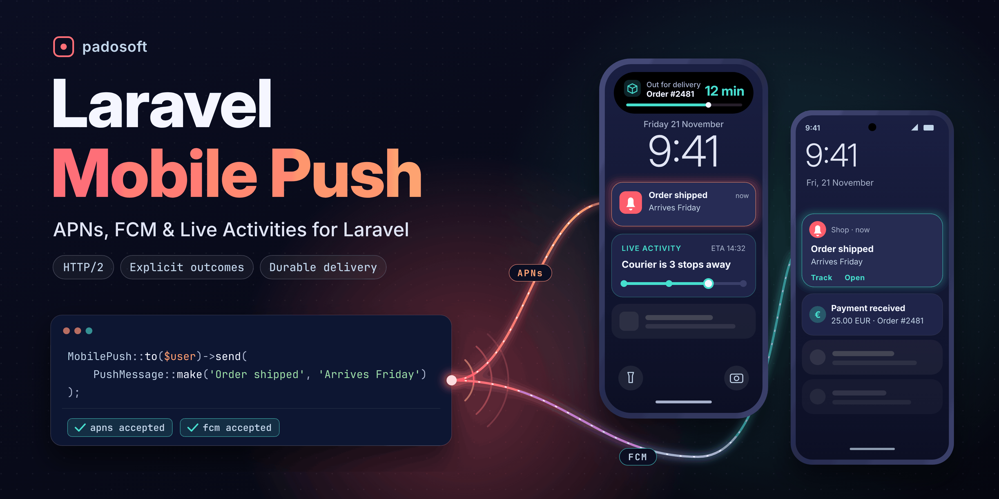

# Laravel Mobile Push



[](https://github.com/padosoft/laravel-mobile-push/actions/workflows/tests.yml)
[](https://github.com/padosoft/laravel-mobile-push/blob/main/LICENSE)

> **APNs, FCM and Live Activities for Laravel: send push notifications directly to Apple and Google over HTTP/2, and always know what happened to each one.**
> One call reaches a user's iPhone through APNs and their Android phone through FCM HTTP v1, with no intermediate service, and returns one explicit result per device: accepted, rejected, deferred, or honestly unknown.

```php
MobilePush::to($user)->send(PushMessage::make('Order shipped', 'Arrives Friday'));
```

::: callout warning "Project status: pre-release" icon:triangle-alert
The package is complete enough to try, but it has **never been run against the real APNs or FCM servers, nor on a real device**, in this project. It is verified against a protocol-level HTTP/2 mock server and against the providers' published schemas. Real-provider verification is the next step before 1.0. The list of what is not yet verified is in the [README](https://github.com/padosoft/laravel-mobile-push#project-status); if you try it against the real services, an issue with what you saw (even "it worked") is the most useful contribution right now.
:::

::: callout info "New here? Start with the walkthrough" icon:compass
[Getting started](/get-started/getting-started) takes an empty Laravel app to a push on your own phone, one step at a time. Then read [Outcomes](/reliability/outcomes) (what "accepted" and "unknown" really mean) and [Safe mode](/reliability/safe-mode) (why nothing leaves your machine by accident). Credentials: [APNs](/get-started/credentials-apns) and [FCM](/get-started/credentials-fcm).
:::

---

## Why this package

::: grids
  ::: grid
    ::: card "Explicit outcomes, including unknown" icon:circle-help
    Every device ends with one status. An unknown outcome is never reported as a failure, never triggers a fallback channel or a token invalidation. See [Outcomes](/reliability/outcomes).
    :::
  :::
  ::: grid
    ::: card "No silent duplicates from libcurl" icon:copy-x
    libcurl re-sends by itself a request whose connection died; the package streams request bodies so such a re-send fails instead of pushing twice. See [HTTP/2 transport](/reference/transport).
    :::
  :::
  ::: grid
    ::: card "Safe by default outside production" icon:shield-check
    With the default `auto` mode only `APP_ENV=production` sends for real; elsewhere every send is simulated. See [Safe mode](/reliability/safe-mode).
    :::
  :::
  ::: grid
    ::: card "Durable when you need it" icon:database
    An optional durable profile records every delivery in a ledger with an outbox and deduplicates by effect key. See [Delivery profiles](/reliability/delivery-profiles).
    :::
  :::
  ::: grid
    ::: card "Live Activities, broadcast channels included" icon:activity
    Start, update and end activities, and publish to iOS 18 broadcast channels. See [Live Activities](/modules/live-activities).
    :::
  :::
  ::: grid
    ::: card "First-class testing fakes" icon:flask-conical
    `MobilePush::fake()` checks what your code asked to send; `MobilePush::fakeTransport()` runs the real pipeline and checks the exact bytes. See [Testing](/sending/testing).
    :::
  :::
:::

---

## Find your way

| You want to | Go to |
|---|---|
| Install it and send a first push | [Getting started](/get-started/getting-started), [APNs credentials](/get-started/credentials-apns), [FCM credentials](/get-started/credentials-fcm), [Configuration reference](/get-started/configuration) |
| Address and build messages | [Sending](/sending/sending), [Messages](/sending/messages), [Notifications and fallback](/sending/notifications-and-fallback), [FCM topics](/sending/topics), [Testing](/sending/testing) |
| Understand what happens when things go wrong | [Outcomes](/reliability/outcomes), [Retries and limits](/reliability/retries-and-limits), [Delivery profiles](/reliability/delivery-profiles), [Queues and Horizon](/reliability/queues-and-horizon), [Safe mode](/reliability/safe-mode) |
| Turn on an optional module (all off by default) | [Devices](/modules/devices), [Live Activities](/modules/live-activities), [Campaigns](/modules/campaigns), [Receipts](/modules/receipts), [Policies](/modules/policies), [Observability](/modules/observability) |
| Run it in production | [Commands](/operations/commands), [Troubleshooting](/operations/troubleshooting), [Multi-tenancy](/operations/multi-tenancy), [Security and privacy](/operations/security-and-privacy), [Runtimes](/operations/runtimes), [Upgrading](/operations/upgrading) |
| Compare, migrate, read the design | [Comparison](/reference/comparison), [Architecture contracts](/reference/contracts/overview), [Benchmarks](/reference/benchmarks), [Migrating from Pushok](/reference/migrating-from-pushok), [Migrating from notification-channels/apn](/reference/migrating-from-notification-channels-apn) |

---

## Requirements

- PHP 8.3 or newer with `ext-curl`, `ext-openssl`, `ext-json`, and a libcurl built with HTTP/2 (7.68 or newer; `php artisan mobile-push:doctor` checks it).
- Laravel 12 or 13.
- A cache store shared by your workers and able to take locks (Redis, Memcached, database, DynamoDB) in production.

## About these pages

Every page of this site except this one is generated from the Markdown files in the repository (`README.md`, `docs/`, `benchmarks/`), so the site and the repository documentation cannot disagree. The PHP examples are executed by the package's test suite. Benchmark figures, where shown, were measured against a local mock server and say nothing about Apple or Google; see [Benchmarks](/reference/benchmarks).

[Source on GitHub](https://github.com/padosoft/laravel-mobile-push) · [Changelog](/reference/changelog) · [Contributing](/reference/contributing) · [Security policy](/reference/security-policy) · MIT licence
